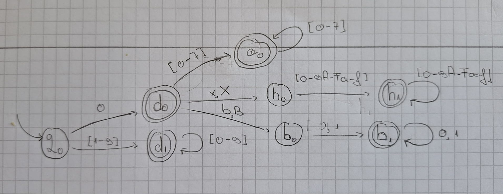
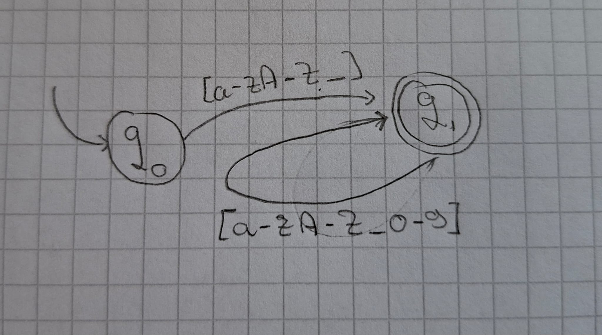
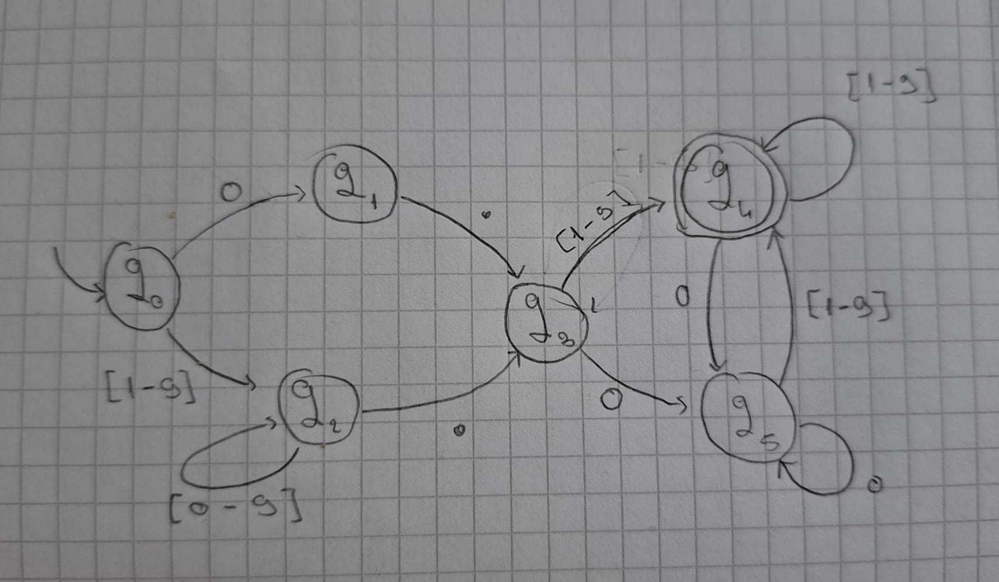
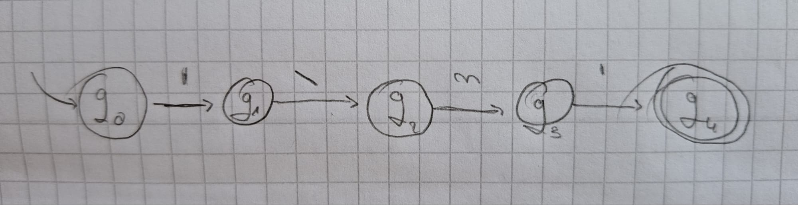

## Part One

### Finite Automata

For this laboratory I made this DFA for integer literals in C++. According to this [website](https://en.cppreference.com/cpp/language/integer_literal) there are 4 types of such literals:
|||
|-|-|
|decimal|`(0\|[1-9][0-9]*)`|
|octal|`0[0-7]*`|
|hex|`(?:0x\|0X)[0-9A-Fa-f]+`|
|binary|`(?:0b\|0B)[01]+`|

If you are a nerd you may have noticed that I didn't add integer-suffix. That is intentional. 



### BNF of the input file

```html
<input> ::= states: <list_of_states>\n alphabet: <list_of_alphabets>\n initial: <state>\n final:  <list_of_states>\n transitions:\n <list_of_transitions>
<list_of_states> ::= <state> | <state>, <list_of_states>
<state> ::= ^[a-z]+[0-9]*$
<list_of_alphabets> ::= <alphabet> | <alphabet>, <list_of_alphabets>
<alphabet> ::= \w-\w | \w
<list_of_transitions> ::= <transition> | <transition>\n <list_of_transitions>
<transition> ::= <state> <alphabet> <state> 
```

## Part Two

For ID we have the following DFA:


For real numbers we have:


For char literals we have:
