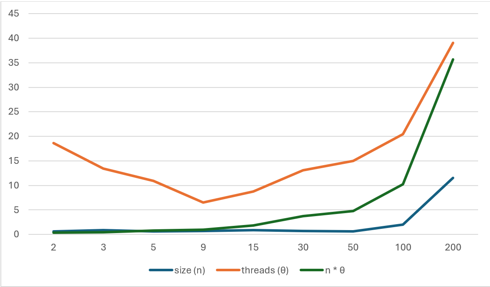
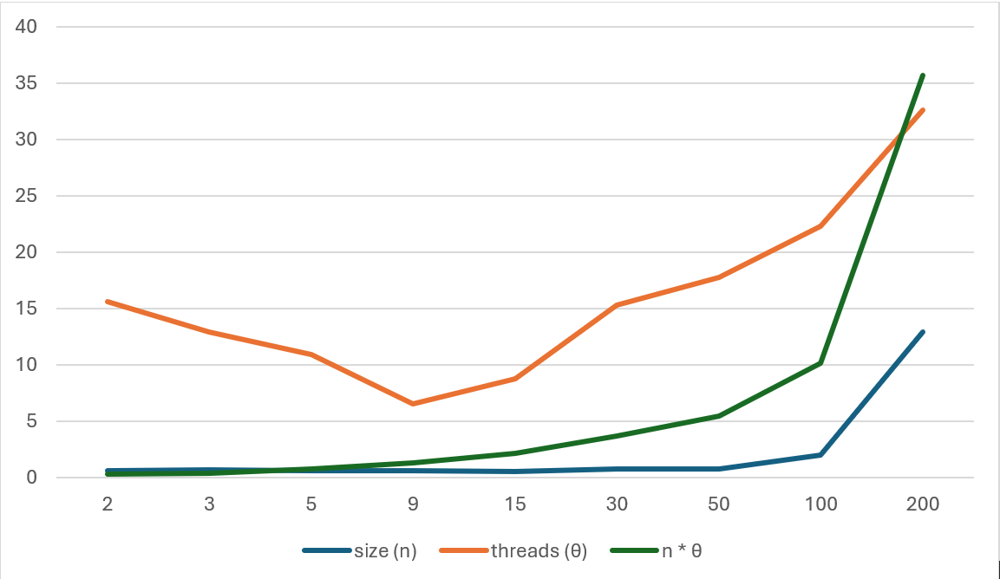
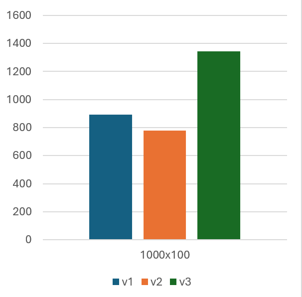
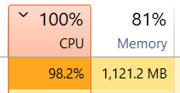

## Method One

For the first method I found the next formulas (`theta` = number of threads, `n` = matrix size):

$ start_k = k \cdot n^2 / \theta $

$ end_k = \begin{cases} start_k + \lfloor n^2 / \theta \rfloor & k < \theta - 1 \\ n^2 & k = \theta - 1 \end{cases} $

```c++
int main() {
    int n = 3, theta = 4;
    const int offset = n * n / theta;
    for (int k = 0; k < theta; ++k) {
        const int start = k * offset;
        const int end = (k == theta - 1) ? n * n : (k + 1) * offset;
        std::cout << "Thread " << k << " [" << start << ", " << end << "): ";
        for (int idx = start; idx < end; ++idx)
            std::cout << '(' << idx / n << ',' << idx % n << ") ";
        std::cout << std::endl;
    }
}
```

> The results of this method are
> 

> [!NOTE]
> For threads I tested with n = 200 

## Method Two

Same `start` / `end` ranges, but the index runs down the columns

$ row = idx \bmod n \qquad col =  idx / n  $

```c++
// method 1 (rows)
computeElement(index / n, index % n);
// method 2 (columns)
computeElement(index % n, index / n);
```

> The results of this method are
> 

There was no visible difference between the methods. When though you would expect that when you load the data in memory you would have to make more drastic jumps.

### Cache behaviour

`C[row][col] += A[row][k] * B[k][col]`

- **Method 1:** consecutive elements share the same row of `A` (read sequentially, cache friendly), while `B` is read down a column with stride `n`, and the column changes at every element.
- **Method 2:** consecutive elements share the same column of `B` (still strided, but the same data is reused for `n` elements), while the row of `A` changes at every element.

## Method Tree

Thread `k` takes the indices

$ idx = k,\; k + \theta,\; k + 2\theta,\; \dots < n^2 $

and uses the same row-major mapping as the first method:

$ row = \lfloor idx / n \rfloor \qquad col = idx \bmod n $


Thread `k` computes $ \lceil (n^2 - k) / \theta \rceil $ elements, so the load differs by at most one element between threads. In the code:

```c++
for (int index = k; index < n * n; index += theta)
    computeElement(index / n, index % n);
```

> The results of this method are
> 

### Cache behaviour

Neighbouring elements of the result are computed by different threads. Two things follow:

- **False sharing on `C`:** if `theta` is small, elements of `C` written by different threads sit in the same cache line (a cache line is 64 bytes, i.e. 8 `long long` values), so the line bounces between cores on every write. In methods 1 and 2 only the thread boundaries share a line.
- **Reads of `A` and `B`:** consecutive elements of one thread are `theta` positions apart, so each thread touches a different row of `A` and a different column of `B` at almost every step, while all threads together still read the same rows and columns around the same time.


> In the end, using the maximum amount of data my laptop can take this are the speed. Here we can clearly see that there is a difference between the versions, that being the caching behaviour.
> 
>  


